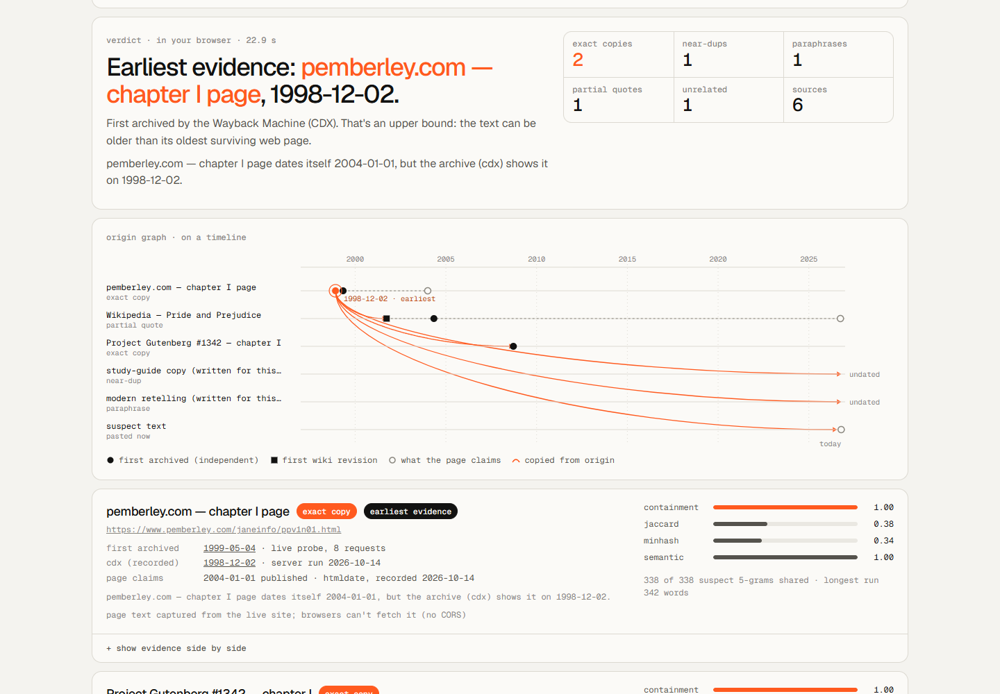

# Tracer — evidence workbench

Paste a text and the places you suspect it came from. Tracer sorts them into exact copies, near-duplicates and paraphrases, highlights the matching words, and compares page-level archive dates. Similarity is a lead, not proof of copying or authorship.

**Live demo: https://temirlanzzz.github.io/tracer/** (runs in your browser, no server, no keys; click "load example")

## Investigation workflow

- **Case shelf:** explicitly save up to 20 named cases in this browser. Same-title saves replace the prior case. Nothing is automatically saved; browser storage can be cleared or unavailable.
- **Portable case files:** export/import a versioned, input-only JSON format. Imports validate lengths, source count and URL schemes, discard unknown fields, clear server settings and require a fresh comparison. They cannot inject trusted archive results.
- **Evidence report:** download a plain-text review record with scores, available archive links, missing evidence and interpretation caveats. It contains private passage text; review before sharing.
- **Interruptible work:** Cancel aborts network requests, terminates model work and suppresses stale results. Partial results remain explicitly incomplete. A later run starts fresh.
- **Evidence-first design:** responsive paper-and-ink workbench, accessible input names, keyboard focus, touch-sized controls, light/dark themes and direction-free similarity links.

The screenshot below documents the previous interface; new browser screenshots have not been verified in the restricted build environment.



There are two versions in this repo:

- **Browser demo** (repo root, GitHub Pages). Word 5-gram shingles, exact Jaccard, containment and 128-permutation MinHash, plus MiniLM sentence embeddings via transformers.js for paraphrases. It shows side-by-side highlighted spans, similarity bars, and an origin graph on a timeline. Dates come from live Wayback probes and the Wikipedia API.
- **Server** (`/server`, FastAPI + Docker). The same pipeline in Python, plus web search (DuckDuckGo HTML, or Brave / SerpAPI with a key), page fetch with trafilatura, htmldate for what the page claims about itself, and Wayback **CDX** for exact first-capture timestamps. The web UI can point at it ("use a Tracer server").

## How it works

1. **Text in.** Pasted text is used as is. Wikipedia URLs are fetched through the Wikipedia API (it sends CORS headers). Other URLs are tried directly, and when the site blocks cross-origin reads you're asked to paste the text.
2. **Lexical.** Lower-case, strip punctuation and diacritics, then cut into word 5-grams. Compute exact Jaccard, a MinHash estimate (128 permutations, FNV-1a + mulberry32-seeded affine hashes), and **containment**: the share of the suspect's 5-grams found in the candidate.
3. **Semantic.** `Xenova/all-MiniLM-L6-v2` (8-bit, transformers.js 3.8.1, in a Web Worker) embeds suspect passages (≥ 12 words) and candidate sentences. Candidate windows of 1–3 sentences are word-weighted means of sentence vectors. *Semantic coverage* is the share of suspect words whose passage has a window at cosine ≥ 0.60.
4. **Class.** containment ≥ 0.90 → exact copy. ≥ 0.40 (or Jaccard ≥ 0.40) → near-duplicate. Otherwise coverage ≥ 0.35 → paraphrase, and containment ≥ 0.05 → partial quote. Anything else is unrelated.
5. **Earliest dated page.** The exact / near / paraphrase candidate with the earliest *independent page-level* date (first archive capture, or first Wikipedia revision). A page's own claimed date is shown and flagged, and only used when nothing independent exists.

`server/tracer/textsim.py` mirrors `assets/js/textsim.js` bit for bit. `server/tests/test_parity.py` checks the Python output against `server/tests/fixtures/parity.json`, which `node scripts/parity.mjs` writes from the JS module.

### What a browser can reach (checked with `curl -H "Origin: https://temirlanzzz.github.io"`, 2026-10-14)

| endpoint | CORS | used by |
|---|---|---|
| `web.archive.org/cdx/search/cdx` | none, blocked | server only |
| `web.archive.org/web/<ts>id_/<url>` (raw snapshot) | none, blocked | — |
| `web.archive.org/__wb/sparkline` | none, blocked | — |
| `wayback-api.archive.org/wayback/available` | `Access-Control-Allow-Origin: *` | browser (probing) |
| `archive.org/wayback/available` | timed out from my network | — |
| `*.wikipedia.org/w/api.php?origin=*` | `*` | browser (text + first revision) |
| `huggingface.co` model files | allowed | browser (MiniLM) |

The availability API only answers "closest capture to T". The browser probes Jan 1 and Jul 1 of each year from 1996 and takes the earliest hit. That is an upper bound on the first capture.

## Results (measured 2026-10-14)

Example: *Pride and Prejudice* ch. 1 opening (342 words) against 6 sources, headless Chrome 155, fresh profile.

| source | containment | Jaccard | MinHash | semantic | class |
|---|---|---|---|---|---|
| pemberley.com chapter page | 1.000 | 0.377 | 0.336 | 1.00 | exact copy |
| Gutenberg #1342 ch. I | 1.000 | 0.398 | 0.383 | 1.00 | exact copy |
| study-guide copy (written for the demo) | 0.447 | 0.350 | 0.414 | 0.68 | near-duplicate |
| modern retelling (written for the demo) | 0.021 | 0.012 | 0.008 | 0.52 | paraphrase |
| Wikipedia article (fetched live) | 0.065 | 0.002 | 0.016 | 0.18 | partial quote |
| Moby-Dick opening | 0 | 0 | 0 | 0.00 | unrelated |

- Origin: **pemberley.com, first archived 1998-12-02** (CDX `19981202085441`). Its own metadata (htmldate) claims 2004-01-01. Gutenberg's HTML file was first captured 2008-09-20; Wikipedia's first revision was 2001-09-26 and its first capture 2004-05-04.
- Time: 19.7 s cold for the text analysis (MiniLM download/init 7.1 s, embeddings 12.5 s, lexical 0.1 s), 13.0 s with the model cached. Live Wayback probes took 1–60 s and are approximate: pemberley came back as 1998-12-02 on three of five runs and 1999-05-04 on two, and Wikipedia as 2004-05-04 or 2004-07-05.
- Server, DuckDuckGo search, no keys: 12 URLs found, 7 fetched (5 failed: connection refused or 403). 5 exact copies, 1 near-duplicate, 1 partial quote. Origin authorama.com, first archived 2004-10-09, while its metadata claims 2025-01-01. 48.4 s cold, 21.8–24.3 s with the Wayback cache warm.
- `pytest`: 21 passed.

## Run locally

Static demo (any static server; relative URLs, so a sub-path works):

```bash
python -m http.server 8080        # then open http://localhost:8080/
```

Server:

```bash
python -m venv .venv && . .venv/bin/activate     # Windows: .venv\Scripts\activate
pip install -r server/requirements.txt
pytest
uvicorn tracer.main:app --app-dir server --port 8787
# optional: BRAVE_API_KEY=... or SERPAPI_KEY=... ; TRACER_CACHE_DIR=.cache for the Wayback cache
# optional paraphrase detection on the server: pip install -r server/requirements-embeddings.txt
```

Then set "use a Tracer server" to `http://localhost:8787` in the page, or call the API directly:

```bash
curl -X POST localhost:8787/api/trace -H 'Content-Type: application/json' \
  -d '{"text": "It is a truth universally acknowledged ...", "search": true}'
```

Docker:

```bash
docker build -t tracer-server server            # add --build-arg EMBEDDINGS=1 for MiniLM (large image)
docker run -p 8787:8000 -v tracer-cache:/data tracer-server
```

## Structure

```
index.html                 page + write-up
assets/js/textsim.js       tokenise, shingles, Jaccard, MinHash, spans, classes (shared logic)
assets/js/wayback.js       availability-API probing (the CORS-enabled archive endpoint)
assets/js/sources.js       Wikipedia API, direct fetch, HTML -> text + claimed dates
assets/js/embed*.js        MiniLM in a Web Worker
assets/js/graph.js         origin graph on a timeline (SVG)
assets/js/app.js           UI and the browser pipeline
assets/data/preset.json    the example, plus server-recorded CDX/htmldate evidence
server/tracer/             FastAPI app: search, fetch, wayback, textsim, embed, pipeline
server/tests/              pytest (incl. JS/Python parity)
scripts/build_preset.py    rebuilds the example and records server evidence
scripts/parity.mjs         writes the parity fixture from the JS module
```

## Limits

- The browser can't read Wayback CDX or archived page text (no CORS), and can't search. Its dates come from probing the availability API, which gives an upper bound, is sometimes empty or rate-limited, and is labelled as a probe.
- Most pages can't be fetched from a browser. Paste their text; the URL is still used for dating.
- The thresholds are tuned on one example, not a benchmark. The paraphrase margin is modest (0.52 vs 0.18), and a close summary of the same scene will read as a paraphrase.
- The two "written for this demo" sources are my own text, made to show a near-duplicate and a paraphrase.
- Server embeddings are optional (PyTorch). Without them it reports `semantic: null`, and that path isn't covered by the tests.
- An archive date is when the archive noticed a page, not when the text was written (here: 1813).


## Verification for the workbench update

```bash
pytest
npm ci
npm test
node scripts/parity.mjs
node --check assets/js/app.js
# Optional real-browser smoke (requires Playwright + Chromium):
python -m http.server 8083
node scripts/browser-smoke.cjs
```

Verified locally: **34 Python tests and 9 Node tests pass**, including a DOM-level compare/save/restore/cancel/stale-response test and delayed-boot regressions for case opening, importing, editing and failed example fetches. The parity fixture regenerates without a diff. Python emits one upstream Starlette/AnyIO deprecation warning.

The deterministic tests cover case round-trips, hostile imports/URLs, discarded forged evidence, report caveats, request limits, private/mixed-address DNS rejection, redirect revalidation and bounded response handling. The browser smoke script covers comparing, saving/opening, case import/export, report export, cancellation/retry, stale result clearing, mobile overflow and console errors. GitHub Actions runs the Python, Node and browser checks on push/PR and uploads screenshots; it does not deploy. Browser execution and fresh screenshots are blocked in the current sandbox by Chromium's Unix-socket restriction; do not treat that script as a completed visual/accessibility audit. Live providers and optional MiniLM downloads have not been revalidated in this update. Earlier measurements above are historical, not new benchmark results.

## Self-hosted server security

The API caps candidate text at 100,000 characters, combined text at one million characters, URLs at 2,048 characters and candidate count at 30. Page fetching rejects credentials, non-HTTP(S) schemes, unusual ports, local literal addresses and non-public DNS answers. Every redirect is revalidated (maximum five redirects); decoded responses stop at 2 MB and only text/HTML is accepted. These are defense-in-depth checks, **not a hardened public fetch proxy**: DNS can change between validation and the connection. Use an outbound firewall that blocks private/reserved networks, bind to localhost, and add authentication/rate limiting before any shared deployment. Default CORS remains permissive for the existing static demo; set TRACER_CORS to your trusted origin for shared use.

Archive capture dates and first Wikipedia revisions are not passage-specific: this tool does not verify that the matching text occurred in the archived version. Missing captures do not establish absence. The API's historical `origin` field is retained for compatibility, but it means earliest dated matching candidate, never established authorship.
